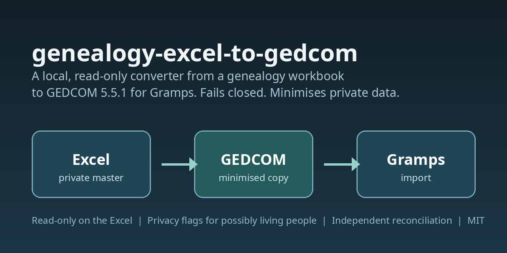

# genealogy-excel-to-gedcom

A local script that converts the sheets of a genealogy Excel workbook (a specific layout, described below) into GEDCOM 5.5.1 for import into Gramps. It only reads the workbook and never writes to it. It is built to fail closed and to minimise private data in the output.

Note: the code, its messages and the sheet and column names (`30_Arbol_Confirmado`, `05_Citas`, ...) are in Spanish, because the workbook it was written for is in Spanish. This README is in English.

## Usage

    python3 mapper.py input.xlsx output.ged

Requires Python 3 and openpyxl. Expected sheets: `30_Arbol_Confirmado`, `02_Relaciones`, `04_Fuentes`, `05_Citas`, `06_Documentos` (header on row 4, except sheet 30).

To try it without any real data, generate the synthetic fixture: `python3 make_fixture.py` writes `fixtures/fixture_sintetico.xlsx`.

## Rules

- Only people in `30_Arbol_Confirmado` and their citations are imported.
- Confidence: Muy alta -> Very high, Alta -> High, Baja -> Low, Media -> Normal, Media-alta -> Normal with a conversion note. Any other value excludes the citation and leaves a note.
- Ranges "c. YYYY-YYYY" become `BET ... AND ...`; "c. YYYY" becomes `ABT`. The original text is kept in a note.
- A union without a spouse/partner row in `02_Relaciones` is created without a marriage event and with a note. It is not treated as proven.
- Documents: per-person notes only (ID, name, type, SHA as given). No files are copied.
- The script prints counts and any differences against `02_Relaciones`.
- By default every citation is linked to the person (fact type, value and PAGE kept). An exact type and a compatible year do not prove that the source documents that specific event. Event binding exists only as an internal `bind_events` parameter of `run()` for tests; the CLI does not expose it.
- All warnings are printed. Long texts use CONC/CONT without truncation. Dates that cannot be mapped keep their original text in a note.

## Fail closed

- Duplicate IDs (person, source, citation, document), invalid XREF format, or person/source collisions stop the run with an error. No row is picked silently.
- Missing sheets or columns, or a missing file: error.
- Citations of people outside the confirmed tree are not imported. They are counted separately, and the summary must reconcile: rows in `05_Citas` = mapped + excluded + out of scope. If it does not add up, the run fails.
- Role conflicts in sheet 30 reject the input (exit code 1, no new output, previous output untouched): a person listed as both father and mother in different children, father and mother being the same person, a couple with father/mother roles swapped between children, or a spouse id pointing to the person itself.
- Output is written atomically (0600 temp file in the same directory, then `os.replace`). On any error the previous output stays intact. Output is rejected (exit code 2) if it is the same file as the input by any alias (different path, symlink, hardlink), a symlink, or a directory.

## Privacy minimisation

The workbook stays the private master. The GEDCOM is a minimised derivative. `RESN privacy` is a flag a consumer can ignore, so the file at rest does not carry the sensitive content.

- A person is flagged `RESN privacy` if they may be alive (no recorded death and born after 1906, or no birth date) or if any of their documents has a `Derechos_privacidad` value other than "Publico" (empty counts as not public). This is a conservative rule, not a determination that someone is alive.
- For flagged people the output omits the personal note and, for their citations, the asserted value, evaluation, document, URL and excerpt. A locator that contains an ID-card/passport number, 8 or more consecutive digits, `@`, `http`, or is longer than 120 characters is replaced by "locator omitted for privacy" (a heuristic, not a guarantee).
- Sources are restricted (generic title, no author, repository, call number or URL) when they have a non-public document, are personal testimony, conversation, message or email, are identity documents, or carry a year after 1906 in title or repository. Other sources omit repository, call number and visible URL when they hold ID numbers, 8+ digits, `@` or `http`.
- Kept: name, sex, birth and death date and place, family links, source link, citation ID, fact type, QUAY, corroborated flag, safe locator, and a document note with only document ID, "file omitted", source ID, citation ID and SHA256 (or its absence).
- Summary counters list every omission by ID and reason. A reconciliation against the workbook must ignore only those declared fields.
- A title that names people who died more than a century ago can still be emitted. This is a heuristic, not a guarantee.

## Independent reconciliation

    python3 reconcile.py input.xlsx output.ged

It compares sheet 30 and `05_Citas` against the GEDCOM without importing `mapper.py`: per person name, sex, places, full date with qualifiers and family links; per citation ID, source and presence; per document (sheet 06) the note, source and citation IDs, SHA state, privacy marker and absence of the file name. It lists every difference with its ID and exits with code 1 if there is any. It does not cover marriage dates or media paths, and it does not compare fields omitted for privacy.

## Media (OBJE), optional, manifest only

    python3 mapper.py input.xlsx output.ged --media-manifest=batch/manifest.csv

The manifest header is exactly `ID_Documento,ruta_relativa,sha256`; files live under the manifest folder. Without a manifest no OBJE is emitted. A file is migrated only if it is in the manifest, its real sha256 matches both the manifest and the 64-hex SHA256 in the workbook, the document privacy starts with Publico/Publica without restrictive marks, and the main person is not possibly alive. Manifest errors (unknown or duplicate ID, absolute path or `../` or `\`, symlink, missing file, wrong hash) stop everything with no new output.

Gramps turns GEDCOM FILE paths into absolute paths on import, and Gramps Web matches ZIP files by exact relative path. Flow: import the GED into Gramps, export `.gramps`, run `python3 gramps_relativize.py x.gramps batch_folder out.gramps` (fails closed if a path ends up outside the folder), import that into Gramps Web and upload the batch ZIP under Administration > Import Media Files. Check that "Media file status" shows 0 missing. Verified locally with Gramps 6.0.0 and synthetic data; not tested on Gramps Web.

## Gramps importer note

The Gramps GEDCOM importer maps QUAY 0,1,2,3 to confidence 0,1,3,4; with no QUAY the confidence is 2. The script uses that mapping.

## Tests

    python3 -m unittest discover -s tests
    python3 -m unittest discover -s gramps_privacidad/tests -p "test_*.py"

The second command skips its integration tests unless `GRAMPS_TEST_BASE` points at a disposable Gramps Web stack. GitHub Actions runs both commands on Python 3.10 and 3.12 (`.github/workflows/tests.yml`, no network services, third-party actions pinned by commit SHA).

## Data

This repository contains no real data. The only fixtures are fictional. Do not commit real workbooks, GEDCOM files or outputs; `.gitignore` blocks them.

`gramps_privacidad/` holds a separate pair of tools for post-import privacy remediation in Gramps Web. See its README.

## License

MIT. See `LICENSE`.
